<div align="center">

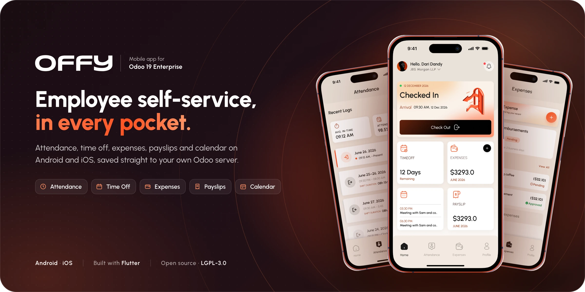

# OFFY

**Employee self-service mobile application for Odoo 19 Enterprise**

[](#5-requirements)
[](#10-mobile-application)
[](#10-mobile-application)
[](offy_mobile_connector_odoo/LICENSE)
[](offy_mobile_app/LICENSE)

[Quick start](#6-quick-start) ·
[Installation](#7-installing-the-odoo-modules) ·
[User administration](#9-user-and-feature-administration) ·
[Firebase](#11-firebase-and-push-notifications) ·
[Troubleshooting](#16-troubleshooting) ·
[API reference](#19-api-reference) ·
[Support and feedback](#22-support-and-feedback)

</div>

---

## Contents

1. [Overview](#1-overview)
2. [Features](#2-features)
3. [Screenshots](#3-screenshots)
4. [Architecture](#4-architecture)
5. [Requirements](#5-requirements)
6. [Quick start](#6-quick-start)
7. [Installing the Odoo modules](#7-installing-the-odoo-modules)
8. [Server configuration](#8-server-configuration)
9. [User and feature administration](#9-user-and-feature-administration)
10. [Mobile application](#10-mobile-application)
11. [Firebase and push notifications](#11-firebase-and-push-notifications)
12. [Attendance geofence](#12-attendance-geofence)
13. [Customisation](#13-customisation)
14. [Production checklist](#14-production-checklist)
15. [End-user guide](#15-end-user-guide)
16. [Troubleshooting](#16-troubleshooting)
17. [FAQ](#17-faq)
18. [Security](#18-security)
19. [API reference](#19-api-reference)
20. [Testing](#20-testing)
21. [Contributing](#21-contributing)
22. [Support and feedback](#22-support-and-feedback)
23. [Licence](#23-licence)

---

## 1. Overview

OFFY gives employees access to their Odoo HR data from a native mobile application, without going through the Odoo web client. All data is read from and written to the organisation's own Odoo database; there is no intermediate cloud service.

The project consists of two components. Both are required.

| Component | Location | Description |
|---|---|---|
| **Odoo modules** | [`offy_mobile_connector_odoo/`](offy_mobile_connector_odoo) | `odx_mobile_connector` and `odx_mobile_api`. They provide a token-authenticated REST API and the administration screens that control the app |
| **Mobile application** | [`offy_mobile_app/`](offy_mobile_app) | Flutter application for Android and iOS |

> [!IMPORTANT]
> The application does not use Odoo's web client or XML-RPC interface. It communicates only with the `/api/mobile/v1` endpoints provided by the modules, so login fails until the modules are installed.

Developer documentation for each component is in [`offy_mobile_connector_odoo/README.md`](offy_mobile_connector_odoo/README.md) and [`offy_mobile_app/README.md`](offy_mobile_app/README.md).

---

## 2. Features

### For employees

| Area | Capabilities |
|---|---|
| **Home** | Today's check-in status, leave balance, current month's expenses, latest payslip and today's schedule |
| **Attendance** | One-tap check-in and check-out; optional GPS geofence; daily logs with hours worked, target hours, completion percentage and on-time/late status |
| **Time Off** | Leave balances; leave requests with automatic duration calculation; upcoming leave, history and approval status |
| **Expenses** | Receipt capture or file upload (up to 5 files of 10 MB each per claim); category, amount and submission for approval; payment tracking; edit or delete before approval |
| **Payslips** | Latest payslip and net pay; PDF viewing and download; history by month |
| **Calendar** | Month and day views; create, edit and delete events |
| **Profile** | Personal, work and bank details; company documents with preview |
| **Notifications and comments** | In-app notifications; optional push notifications; comments with mentions and attachments on requests, expenses and payslips |
| **General** | Multi-company switching; 10 languages; light and dark themes; first-launch onboarding; live updates over WebSocket |

Supported languages: English, Arabic, Chinese (Simplified and Traditional), French, German, Hindi, Japanese, Portuguese, Spanish.

### For administrators (in Odoo)

- Grant or revoke app access per user.
- Enable or disable Attendance, Time Off, Expenses, Payslips and Calendar globally or per user, without an app release.
- Configure an attendance geofence globally or per work location.
- Limit the number of devices per user and review active sessions.
- Publish the Privacy Policy, Terms & Conditions and FAQ displayed in the app.

Employees can access only their own records. Standard Odoo access rights, record rules and multi-company rules apply.

---

## 3. Screenshots

<table>
  <tr>
    <td align="center">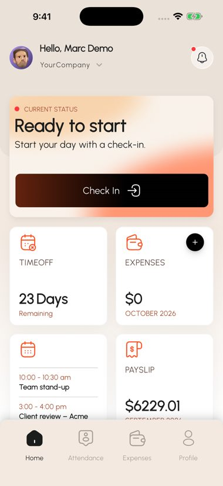<br/><sub>Home</sub></td>
    <td align="center">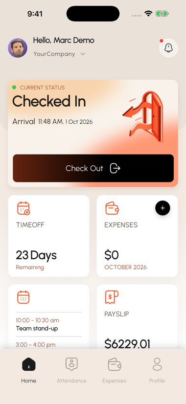<br/><sub>Checked in</sub></td>
    <td align="center">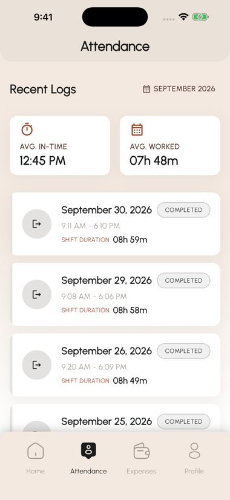<br/><sub>Attendance logs</sub></td>
    <td align="center">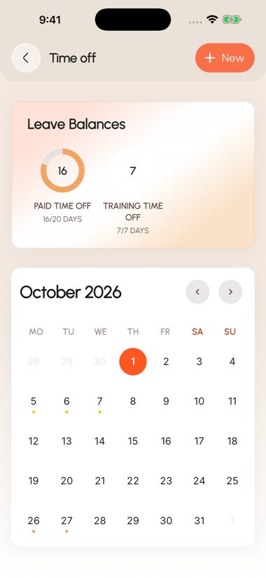<br/><sub>Time off</sub></td>
  </tr>
  <tr>
    <td align="center">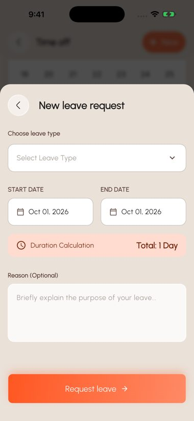<br/><sub>Leave request</sub></td>
    <td align="center">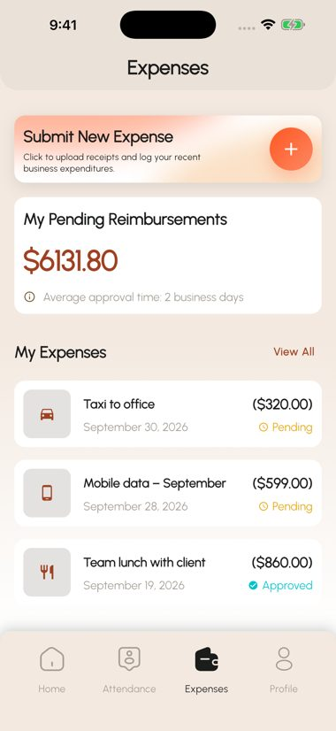<br/><sub>Expenses</sub></td>
    <td align="center">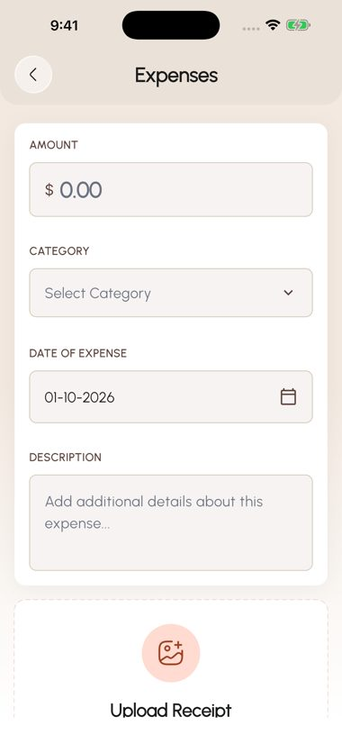<br/><sub>New expense</sub></td>
    <td align="center">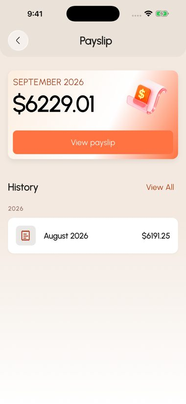<br/><sub>Payslip</sub></td>
  </tr>
  <tr>
    <td align="center">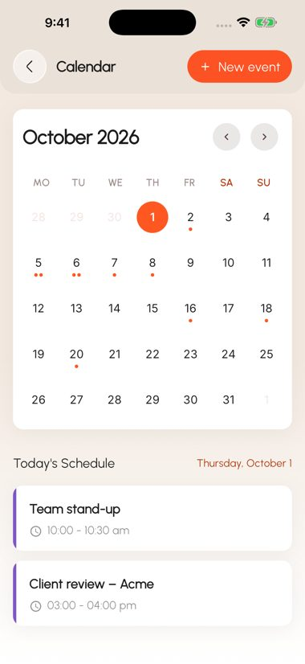<br/><sub>Calendar</sub></td>
    <td align="center">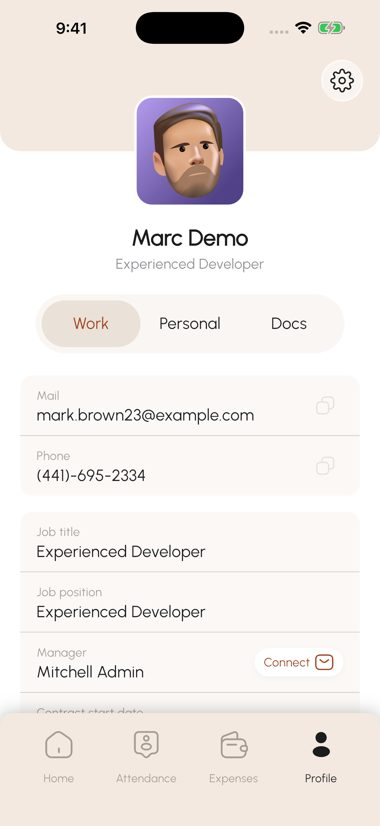<br/><sub>Profile</sub></td>
    <td align="center">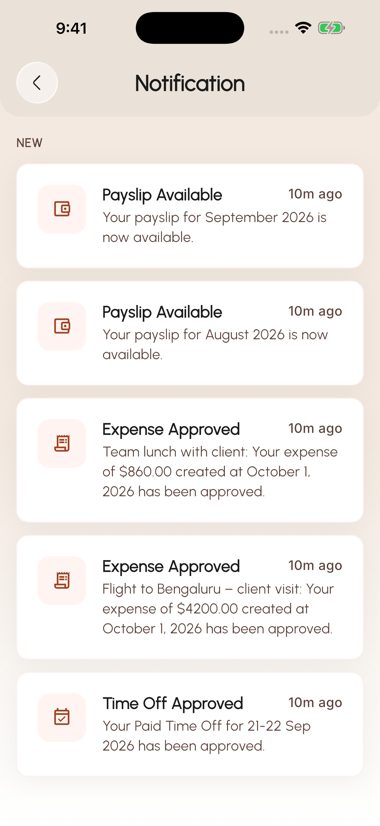<br/><sub>Notifications</sub></td>
    <td align="center">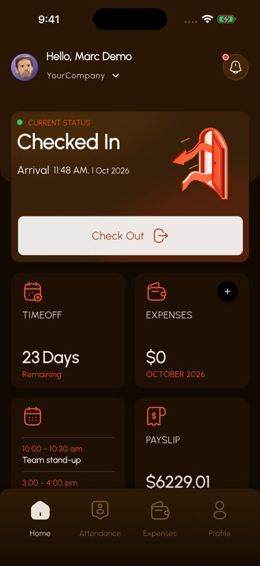<br/><sub>Dark theme</sub></td>
  </tr>
</table>

---

## 4. Architecture

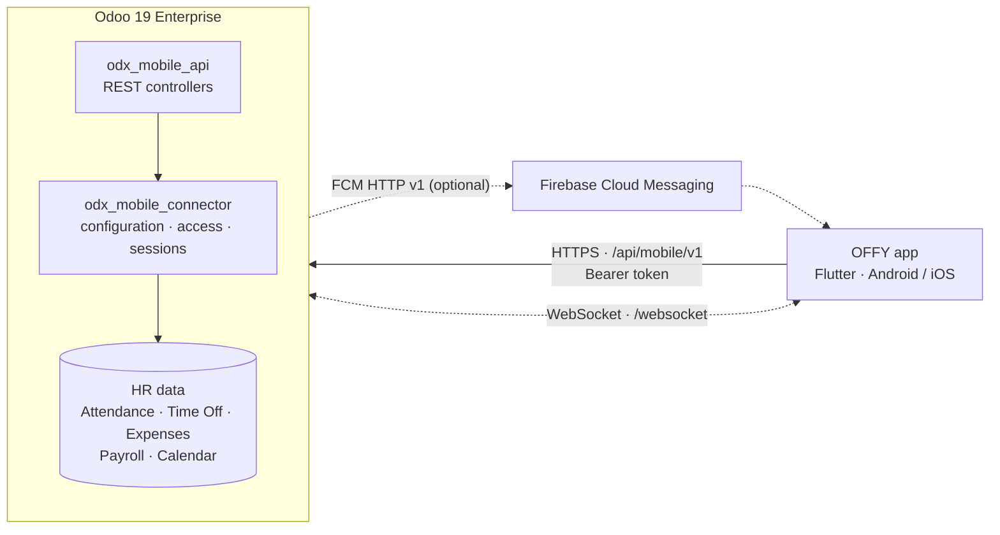

| Concern | Implementation |
|---|---|
| **Authentication** | `POST auth/login` returns an access token (an Odoo API key with scope `mobile_api`) and a refresh token. Every subsequent request sends `Authorization: Bearer <token>` |
| **Authorisation** | Requests run as the authenticated Odoo user. `GET user/access-details` returns the features granted to that user, and feature endpoints return HTTP 403 when a feature is not granted |
| **Live updates** | The app subscribes to Odoo's `/websocket` using a short-lived ticket. Feature and data changes are pushed to connected devices |
| **Push notifications** | Optional, disabled by default, delivered through Firebase Cloud Messaging. In-app notifications work without them |

---

## 5. Requirements

### Odoo server

| Item | Requirement |
|---|---|
| Edition | **Odoo 19.0 Enterprise**. `odx_mobile_api` depends on `hr_payroll`, which is part of Enterprise |
| Hosting | Self-hosted or Odoo.sh. Custom modules must be installable |
| Not supported in this release | Odoo Community · Odoo Online (odoo.com-hosted databases) · Odoo versions earlier than 19.0. See the [FAQ](#17-faq) for planned support |
| Odoo applications | Employees, Attendances, Time Off, Payroll, Expenses, Calendar, Discuss. Missing applications are installed as dependencies |
| Python packages | None beyond Odoo's `requirements.txt` |
| Network | A public HTTPS address reachable from employees' devices, with WebSocket upgrades forwarded to Odoo |
| Outbound access (push only) | HTTPS to `oauth2.googleapis.com` and `fcm.googleapis.com` |

### Mobile application (building from source)

| Item | Requirement |
|---|---|
| Flutter / Dart | Flutter 3.44 or later (stable channel), Dart SDK `^3.12.0` |
| Android | Android SDK, JDK 17 |
| iOS | macOS with Xcode and CocoaPods; deployment target iOS 15.0; Apple Developer account for device and store builds |
| Firebase | A Firebase project, the Firebase CLI and the FlutterFire CLI ([section 11](#11-firebase-and-push-notifications)) |

---

## 6. Quick start

Prerequisites: an Odoo 19 Enterprise server where you can install modules, and a Flutter development environment.

```bash
# 1. Clone the repository
git clone -b offy-odoo-19-enterprise https://github.com/odoxsofthub/offy.git
cd offy

# 2. Install the Odoo modules
cp -r offy_mobile_connector_odoo/odx_mobile_connector \
      offy_mobile_connector_odoo/odx_mobile_api /opt/odoo/custom/
# /opt/odoo/custom and the Enterprise addons directory must both be on addons_path
odoo-bin -c /etc/odoo/odoo.conf -d YOUR_DB -i odx_mobile_connector --stop-after-init
sudo systemctl restart odoo

# 3. Generate the Firebase configuration for your own project (required once)
cd offy_mobile_app
dart pub global activate flutterfire_cli
flutterfire configure --project=YOUR_FIREBASE_PROJECT_ID

# 4. Run the application
flutter pub get
flutter run
```

Then, in Odoo:

1. **Settings → Users & Companies → Users** → select the user → **Access Rights** → enable **Mobile User** → **Save**.
2. **Employees** → select the employee → **Settings** tab → set **User** to that user.
3. In the app, enter the server URL (for example `https://hr.example.com`), the Odoo login and the password.

> [!IMPORTANT]
> The repository contains no Firebase configuration. `lib/firebase_options.dart`, `android/app/google-services.json` and `ios/Runner/GoogleService-Info.plist` are excluded by `.gitignore`, and the application does not compile until `flutterfire configure` has generated them ([section 11.1](#111-application-configuration)).

---

## 7. Installing the Odoo modules

### 7.1 Repository layout

```
offy/
├── offy_mobile_connector_odoo/
│   ├── odx_mobile_connector/      install this module
│   └── odx_mobile_api/            installed automatically with odx_mobile_connector
├── offy_mobile_app/               Flutter application
└── docs/images/                   documentation images
```

### 7.2 Deploy the module files

Copy **both** module directories to a custom addons directory, for example `/opt/odoo/custom/`, and make them readable by the Odoo service user:

```bash
sudo chown -R odoo:odoo /opt/odoo/custom
sudo find /opt/odoo/custom -type d -exec chmod 755 {} \;
sudo find /opt/odoo/custom -type f -exec chmod 644 {} \;
```

Add the directory to `addons_path` together with the Enterprise addons, then restart Odoo:

```ini
addons_path = /opt/odoo/odoo/addons,/opt/odoo/enterprise,/opt/odoo/custom
```

> [!NOTE]
> Odoo does not list a module whose `__manifest__.py` it cannot read, and reports no error.

**Odoo.sh:** commit both directories to the branch repository. Odoo.sh adds them to the addons path on the next build.

### 7.3 Install

Install **OFFY Connector** (`odx_mobile_connector`) only. `odx_mobile_api` is declared `auto_install` and is installed with it.

**From the user interface**

1. Activate developer mode (**Settings → Developer Tools → Activate the developer mode**).
2. **Apps → Update Apps List**.
3. Remove the **Apps** filter, search for **OFFY Connector** and click **Activate**.

   <p align="center">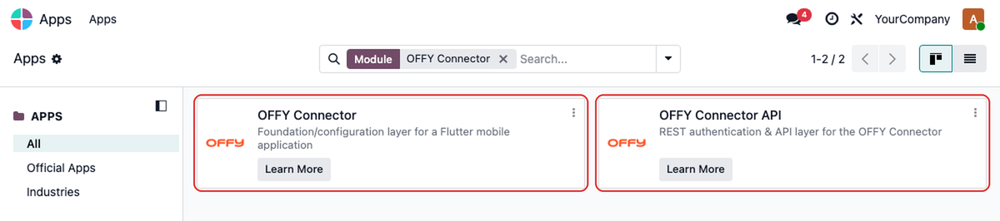</p>

4. After installation, **OFFY Connector** appears on the Odoo home screen.

   <p align="center">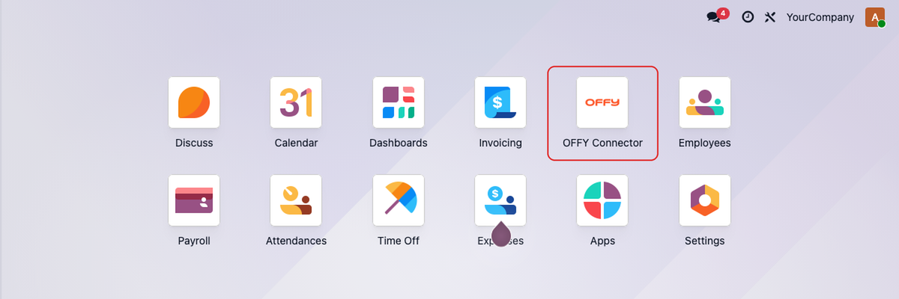</p>

**From the command line**

```bash
odoo-bin -c /etc/odoo/odoo.conf -d YOUR_DB -i odx_mobile_connector --stop-after-init
```

**Upgrade** (after replacing the module files):

```bash
odoo-bin -c /etc/odoo/odoo.conf -d YOUR_DB -u odx_mobile_connector,odx_mobile_api --stop-after-init
```

Restart the Odoo service after every install or upgrade.

### 7.4 Initial state after installation

- Five features: Attendance, Expense, Time Off, Payslip and Calendar.
- One configuration record with login enabled, push notifications disabled, no Firebase credential and the geofence disabled.
- Unpublished placeholder Privacy Policy and Terms & Conditions.
- Four security groups and four scheduled actions ([section 18](#18-security)).
- The `admin` user is assigned **Mobile App Administrator**.
- No demonstration users, employees or other sample data.

### 7.5 Installation errors

If an error is not listed here, contact [support](#22-support-and-feedback).

The connector's pre-installation check stops the installation with one of these messages:

| Message | Cause and resolution |
|---|---|
| *OFFY Connector API is missing. Copy both 'odx_mobile_connector' and 'odx_mobile_api' to an addons_path, update the Apps List, then try again.* | Only one module directory was deployed. Deploy both |
| *OFFY Connector cannot be installed because required module(s) are unavailable: hr_payroll … The bundled Payslip API requires Odoo 19 Enterprise; add the Enterprise addons directory to addons_path.* | The Enterprise addons directory is not on `addons_path`, or the server runs Community |

---

## 8. Server configuration

### 8.1 Database selection

The application does not send a database name. Odoo must therefore resolve the database from the request host.

| Server setup | `odoo.conf` |
|---|---|
| Single database | No setting required; `dbfilter` is recommended |
| One database per domain (e.g. `hr.example.com` → `hr`) | `dbfilter = ^%d$` |
| Multiple databases, one served | `dbfilter = ^your_database$` |

If no database can be resolved, `auth/login` returns HTTP 404 and the app reports *"Unable to connect to the server. Verify the server URL and try again."*

### 8.2 Recommended `odoo.conf`

```ini
[options]
addons_path = /opt/odoo/odoo/addons,/opt/odoo/enterprise,/opt/odoo/custom
dbfilter    = ^%d$
proxy_mode  = True      ; required behind a reverse proxy
workers     = 4         ; workers > 0 starts the dedicated WebSocket (gevent) process
gevent_port = 8072
list_db     = False
```

### 8.3 Reverse proxy

`/websocket` must be forwarded to the gevent port with the `Upgrade` and `Connection` headers. Otherwise live updates stop working. Example for nginx:

```nginx
upstream odoo     { server 127.0.0.1:8069; }
upstream odoochat { server 127.0.0.1:8072; }
map $http_upgrade $connection_upgrade { default upgrade; '' close; }

server {
    listen 443 ssl;
    server_name hr.example.com;
    ssl_certificate     /etc/letsencrypt/live/hr.example.com/fullchain.pem;
    ssl_certificate_key /etc/letsencrypt/live/hr.example.com/privkey.pem;
    client_max_body_size 50m;   # an expense accepts up to 5 receipts of 10 MB each

    location /websocket {
        proxy_pass http://odoochat;
        proxy_set_header Upgrade $http_upgrade;
        proxy_set_header Connection $connection_upgrade;
        proxy_set_header X-Forwarded-Host $host;
        proxy_set_header X-Forwarded-For $proxy_add_x_forwarded_for;
        proxy_set_header X-Forwarded-Proto $scheme;
    }
    location / {
        proxy_pass http://odoo;
        proxy_set_header X-Forwarded-Host $host;
        proxy_set_header X-Forwarded-For $proxy_add_x_forwarded_for;
        proxy_set_header X-Forwarded-Proto $scheme;
    }
}
```

### 8.4 HTTPS

Serve Odoo over HTTPS. Every request carries the user's access token.

- **Android:** the application does not permit cleartext traffic, so `http://` server URLs fail.
- **iOS:** `Info.plist` currently sets `NSAllowsArbitraryLoads`. Remove it for production builds if only HTTPS servers are used.

### 8.5 Public base URL

In developer mode, set **Settings → Technical → System Parameters → `web.base.url`** to the public HTTPS address (for example `https://hr.example.com`). Payslip and attachment download URLs are generated from this value.

### 8.6 Mobile configuration

**OFFY Connector → Configuration** is available to users with the **Mobile App Administrator** access level.

<p align="center">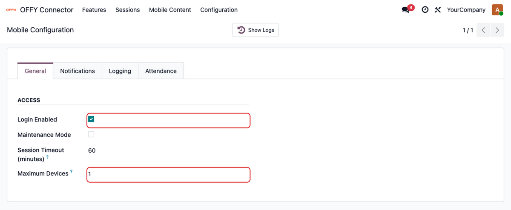</p>

| Setting (General tab) | Default | Description |
|---|---|---|
| Login Enabled | Enabled | Disabling it blocks all mobile logins (*"Mobile login is currently disabled."*) |
| Maintenance Mode | Disabled | Blocks logins with *"The mobile app is under maintenance."* |
| Session Timeout (minutes) | 60 | Access-token lifetime. The app renews it with the refresh token, which is valid for 30 days |
| Maximum Devices | 1 | Concurrent sessions per user. When exceeded, the oldest sessions are revoked. `0` = unlimited |

| Tab | Contents |
|---|---|
| Notifications | Push notifications and the Firebase credential ([section 11.3](#113-odoo-configuration)) |
| Logging | Activity log and user-access change logging in the feature chatter |
| Attendance | Geofence settings ([section 12](#12-attendance-geofence)) |

| Menu | Purpose |
|---|---|
| **OFFY Connector → Features** | Enable or disable features globally or per user |
| **OFFY Connector → Sessions** | Active sessions with device, platform and app version, and registered push tokens |
| **OFFY Connector → Mobile Content** | Privacy Policy, Terms & Conditions and FAQ shown in the app. Publish your own before going live |

---

## 9. User and feature administration

### 9.1 Login prerequisites

A user can sign in only if all of the following are true:

1. The user is an **internal** Odoo user. Portal and public users cannot be granted mobile access.
2. **Mobile User** is enabled on the user.
3. The user is set as the **User** of an active employee.

### 9.2 Granting access

1. Create the employee in **Employees** if it does not exist.
2. In **Settings → Users & Companies → Users**, open the user. On **Access Rights**, under **OFFY Connector**, enable **Mobile User** and save.

   <p align="center">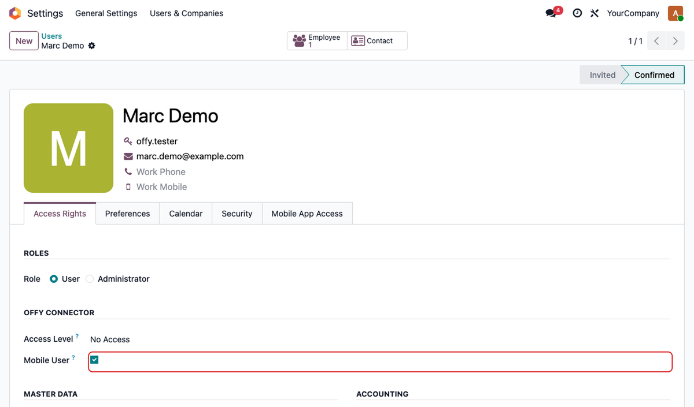</p>

   **Access Level** controls access to the OFFY Connector administration menus, not to the app. Leave it at *No Access* for regular employees.

3. A **Mobile App Access** tab appears, listing the features available to the user. Enabling Mobile User grants all active features.

   <p align="center">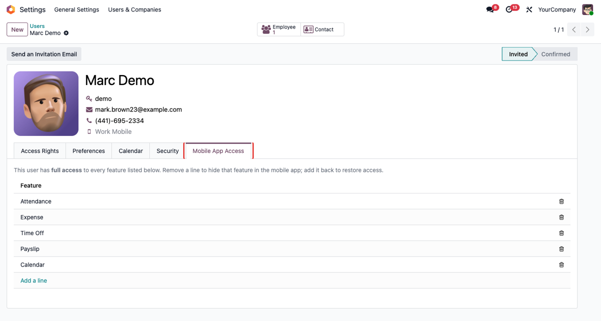</p>

4. Open the employee and, on the **Settings** tab, set **User**.

   <p align="center">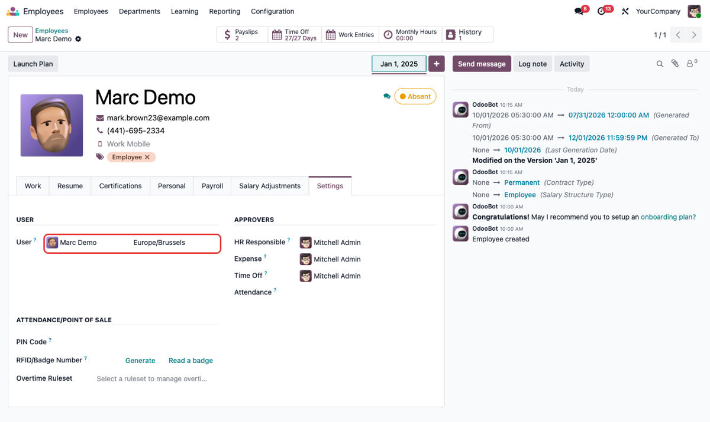</p>

5. Provide the employee with the server URL and their Odoo credentials.

**Revoking access:** disable **Mobile User**. The user's feature grants are removed. Changing a user's password also revokes that user's mobile sessions.

### 9.3 Required HR data

The app displays existing Odoo data. Configure it as you would for the web client:

| App area | Required data |
|---|---|
| Attendance targets | Working schedule and timezone on the employee |
| Time Off balances | Time off types and allocations |
| Payslips | Contract and generated payslips |
| Expenses | Expense categories |
| Approvals | Time off, expense and employee managers (standard Odoo approval flows) |

### 9.4 Feature access

| Feature | Code | Scope |
|---|---|---|
| Attendance | `attendance` | Check-in/check-out, logs and worked hours |
| Expense | `expense` | Create, edit, submit and delete expense claims |
| Time Off | `time_off` | Balances, history, upcoming leave and requests |
| Payslip | `payslip` | View and download payslips |
| Calendar | `calendar` | View, create, edit and delete events |

Access is deny-by-default: a feature is available only when it is **active** and **granted** to the user. A grant gives full use of the feature; there is no read-only level.

**Disable a feature for all users:** in **OFFY Connector → Features**, switch off **Active**. The change is saved immediately.

<p align="center">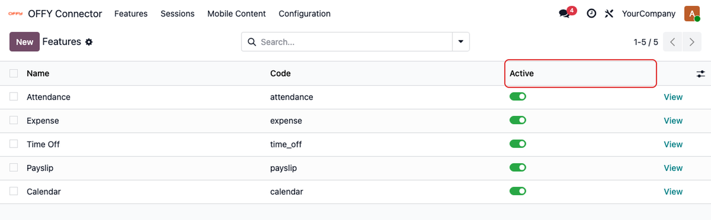</p>

**Disable a feature for one user**, by either of these routes (both edit the same records):

- **Settings → Users → [user] → Mobile App Access**: remove the feature line.
- **OFFY Connector → Features → [feature] → User Access**: remove the user line.

<p align="center">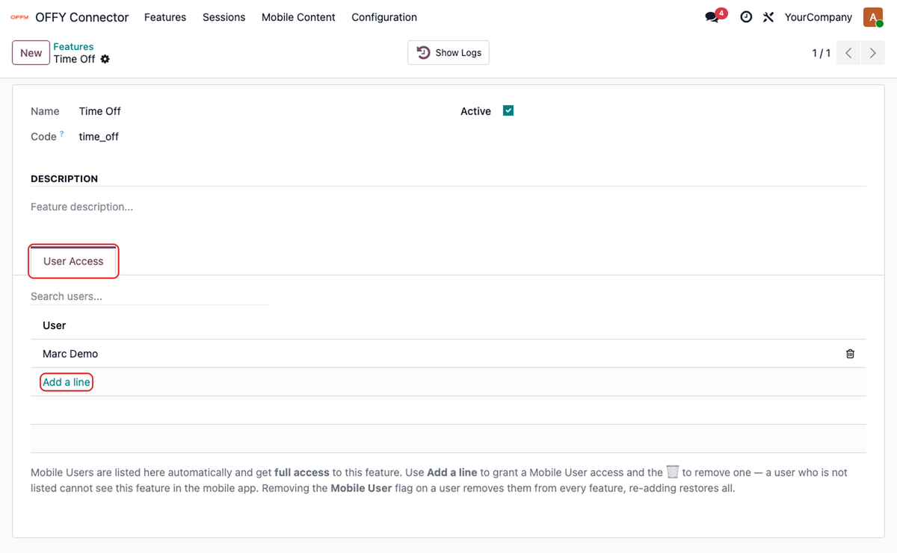</p>

**Restrict a feature to some users:** enable Mobile User for each person, then remove the others from the feature's **User Access** tab.

Both global and per-user changes are pushed to connected devices over the WebSocket. A device that is not connected applies them the next time it loads `user/access-details`. The server enforces the same rules: endpoints of a disabled feature return HTTP 403.

### 9.5 Sessions

**OFFY Connector → Sessions** lists active sessions with device, platform and app version.

<p align="center">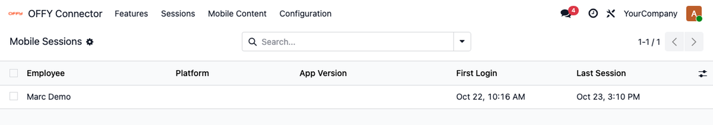</p>

---

## 10. Mobile application

### 10.1 Build and run

```bash
cd offy_mobile_app
flutterfire configure --project=YOUR_FIREBASE_PROJECT_ID   # once, see section 11.1
flutter pub get
flutter run
```

Localisations are generated during the build (`generate: true` in `pubspec.yaml`, sources in `lib/l10n/`).

### 10.2 Connecting to a server

The application is not bound to a server. On the login screen the user enters:

| Field | Value |
|---|---|
| URL | The Odoo base address, e.g. `https://hr.example.com`, without `/odoo` or `/web` |
| Email or Username | The Odoo login |
| Password | The Odoo password |

The URL is remembered on the device. To pre-fill it in a dedicated build:

```bash
flutter run --dart-define=API_BASE_URL=https://hr.example.com
```

A URL entered by the user takes precedence over this value.

### 10.3 Release builds

```bash
flutter build appbundle --release   # Google Play
flutter build apk --release         # direct distribution
flutter build ipa --release         # App Store / TestFlight
```

> [!WARNING]
> Android `release` builds are signed with the upload key described in `android/key.properties`. Without that file, `android/app/build.gradle.kts` falls back to the debug key, which Google Play rejects. Create the file before publishing:

```properties
# android/key.properties (git-ignored)
storePassword=<keystore password>
keyPassword=<key password>
keyAlias=upload
storeFile=/absolute/path/to/upload-keystore.jks
```

The keystore and `key.properties` are excluded by `.gitignore`.

### 10.4 Application identifiers

The application ID is `com.offy.odox`. Builds published under another account must use their own identifiers, and the Firebase apps must be registered with them.

| Location | Change |
|---|---|
| `android/app/build.gradle.kts` | `namespace` and `applicationId` |
| `android/app/src/main/kotlin/com/offy/odox/MainActivity.kt` | Move to the matching package directory and update `package` |
| Xcode → Runner → General | Bundle Identifier (also for `RunnerTests`) |
| Xcode → Runner → Signing & Capabilities | Development team (none is set in the project) |

### 10.5 Update feed (optional)

The app can prompt users to update, or force an update, using an appcast XML file that you host, for example in a public GitHub repository. The feed URL is a build-time value:

```bash
cp env.example.json env.json          # git-ignored; set APPCAST_URL (and optionally API_BASE_URL)
flutter build appbundle --release --dart-define-from-file=env.json
```

If `APPCAST_URL` is not set, or is not a valid `http(s)` URL, the update check is disabled and the app works normally. The feed format, hosting on GitHub and the force-update rules are documented in [`offy_mobile_app/README.md`](offy_mobile_app/README.md#app-update-feed-appcast).

---

## 11. Firebase and push notifications

Firebase is used in two independent places:

| | Purpose | Required |
|---|---|---|
| **Application** | Firebase Core, Cloud Messaging (receiving push), Crashlytics and Performance Monitoring. Firebase is initialised at every launch | Always, when building the app |
| **Odoo** | A service-account key used by Odoo to send push notifications | Only when push notifications are enabled |

The application build and the Odoo service-account key must belong to the **same Firebase project**.

### 11.1 Application configuration

1. In the [Firebase console](https://console.firebase.google.com/), create a project and register an Android app and an iOS app with your identifiers ([section 10.4](#104-application-identifiers)).
2. Install the tooling:

   ```bash
   npm install -g firebase-tools
   dart pub global activate flutterfire_cli
   firebase login
   ```

3. From `offy_mobile_app/`, generate the configuration:

   ```bash
   flutterfire configure --project=YOUR_FIREBASE_PROJECT_ID
   ```

   | Generated file | Purpose |
   |---|---|
   | `lib/firebase_options.dart` | Options used by `Firebase.initializeApp` |
   | `android/app/google-services.json` | Android configuration |
   | `ios/Runner/GoogleService-Info.plist` | iOS configuration |
   | `firebase.json` | FlutterFire CLI metadata |

   These files are excluded by `.gitignore`.

### 11.2 iOS push requirements

1. Create an APNs authentication key (**Apple Developer → Certificates, Identifiers & Profiles → Keys**) and upload the `.p8` file in **Firebase → Project settings → Cloud Messaging → Apple app configuration**.
2. In Xcode (`ios/Runner.xcworkspace`), add the **Push Notifications** capability and **Background Modes → Remote notifications**.
3. `ios/Runner/Runner.entitlements` sets `aps-environment` to `development`. App Store and TestFlight builds require `production`.
4. Run `pod install` in `ios/` after changing Firebase or plugin versions.

On Android, no additional setup is required. The app uses the notification channel `odox_mobile_default` and the small icon `ic_stat_offy`.

### 11.3 Odoo configuration

1. In the Firebase console, open the project used by the app build and select **Project settings → Service accounts → Generate new private key**. Store the downloaded JSON file securely.
2. In Odoo, open **OFFY Connector → Configuration → Notifications**.
3. Upload the file in **Service Account JSON**. The Firebase project ID and client e-mail are filled in from the file.
4. Click **Validate Firebase Credentials** and confirm that **Credential Status** is *Valid*.
5. Enable **Push Notifications Enabled** and save.

<p align="center">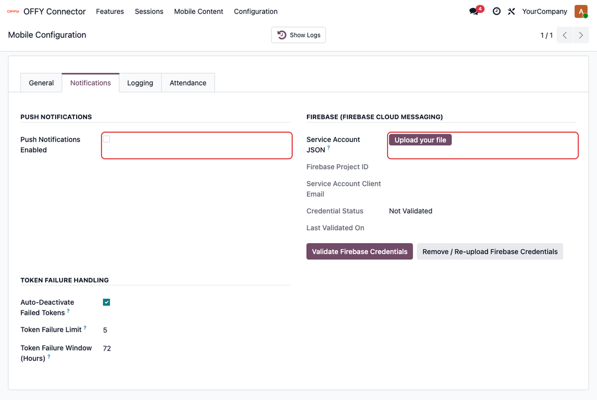</p>

Behaviour:

- Push Notifications Enabled cannot be saved without a credential. **Remove / Re-upload Firebase Credentials** deletes the credential and disables push.
- When push is enabled, the app requests notification permission and registers the device when the Home screen opens. When it is disabled, the app does neither.
- Notifications are queued and sent by a scheduled action that runs every minute. Notifications created while push is disabled are retained and delivered after it is enabled.
- **Token Failure Handling** deactivates device tokens that fail repeatedly. By default, that is 5 failures within 72 hours.

### 11.4 Verification

1. **OFFY Connector → Sessions** shows a registered device token for the device.
2. Trigger a notification, for example by approving a leave request for the employee.
3. If no notification arrives, see [section 16.3](#163-common-issues).

---

## 12. Attendance geofence

Check-ins are grouped by calendar day in the **employee's timezone** (Employee form → **Work** tab). A shift crossing midnight appears on both dates, with its hours split between them.

The geofence is disabled by default.

### 12.1 Global settings

**OFFY Connector → Configuration → Attendance**

<p align="center">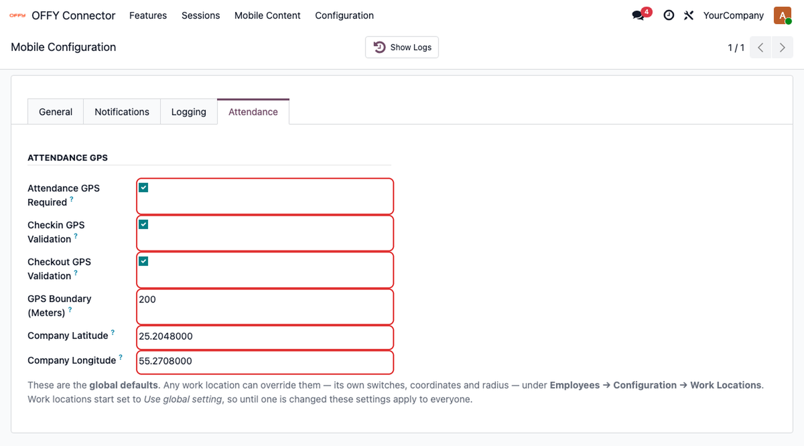</p>

| Field | Description |
|---|---|
| Attendance GPS Required | Master switch; the device must provide its location to check in or out |
| Checkin GPS Validation / Checkout GPS Validation | Apply the boundary to check-in, check-out or both |
| GPS Boundary (Meters) | Radius around the reference point, from 50 to 5000 m (default 50) |
| Company Latitude / Longitude | Reference point, used for employees whose work location has no coordinates |

### 12.2 Per work location

In **Employees → Configuration → Work Locations**, open a location and use the **Mobile Attendance Geofence** section. You can set separate coordinates and a separate boundary, and choose *Use global setting*, *Yes* or *No* for each validation. Employees use the geofence of their work location.

<p align="center">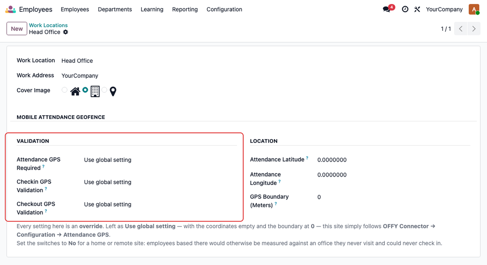</p>

---

## 13. Customisation

| Item | Location (in `offy_mobile_app/`) |
|---|---|
| App name | `lib/main.dart` (`MaterialApp.title`), `android/app/src/main/AndroidManifest.xml` (`android:label`), `ios/Runner/Info.plist` (`CFBundleDisplayName`, `CFBundleName`) |
| Identifiers | [Section 10.4](#104-application-identifiers) |
| App icon | `android/app/src/main/res/mipmap-*/`, `ios/Runner/Assets.xcassets/AppIcon.appiconset/` |
| Logo and splash | `assets/images/` (referenced in `lib/core/constants/app_assets.dart`), `android/app/src/main/res/drawable*/launch_background.xml`, iOS `LaunchScreen.storyboard` |
| Colours and themes | `lib/core/theme/app_colors.dart`, `lib/core/theme/app_theme.dart` |
| External links | `lib/core/constants/app_links.dart` |
| Support e-mail | `lib/core/utils/support_email_launcher.dart` |
| Languages | `lib/l10n/*.arb`; register new languages in `lib/presentation/screens/language/language_page.dart` |
| Privacy Policy, Terms, FAQ | Managed in Odoo (**OFFY Connector → Mobile Content**) |

### 13.1 Links to review before distributing a build

`lib/core/constants/app_links.dart` defines:

| Constant | Used by | Current value |
|---|---|---|
| `odooModuleInstall` | "Install now" on onboarding and on the login screen | This repository (`https://github.com/odoxsofthub/offy/tree/offy-odoo-19-enterprise`) |
| `appcast` | Update check at launch and resume; can display *update available* and *force update* screens | Read from the build-time variable `APPCAST_URL`. Not set: the update check is disabled ([section 10.5](#105-update-feed-optional)) |

Builds distributed under another name should point the install link at their own resources.

### 13.2 Extending

- **Application:** see [`offy_mobile_app/README.md`](offy_mobile_app/README.md) for the architecture and the steps to add a feature.
- **Odoo:** see [`offy_mobile_connector_odoo/README.md`](offy_mobile_connector_odoo/README.md) for the request lifecycle, data model and the steps to add a feature or an endpoint.

---

## 14. Production checklist

- [ ] Odoo 19.0 Enterprise; core and Enterprise addons at the same revision
- [ ] Both modules on `addons_path`; OFFY Connector installed
- [ ] `dbfilter` configured; HTTPS with a valid certificate; `/websocket` forwarded; `proxy_mode = True`
- [ ] `web.base.url` set to the public HTTPS address
- [ ] Login Enabled, Maintenance Mode off, Maximum Devices set
- [ ] Features enabled as required
- [ ] Employees: Mobile User enabled, linked user, working schedule, timezone, time off allocations
- [ ] Privacy Policy and Terms & Conditions published
- [ ] Optional: geofence configured
- [ ] Optional: Firebase credential uploaded and validated; push enabled
- [ ] Login and `user/access-details` verified with cURL ([section 16.1](#161-verifying-the-server-with-curl)); app tested on Android and iOS
- [ ] Own builds: own identifiers, Firebase project, release signing key, `APPCAST_URL` (or none) and links

---

## 15. End-user guide

Employees sign in with the server URL provided by their organisation and their Odoo credentials. The session persists until they sign out.

| Task | Steps |
|---|---|
| Check in / check out | **Home** → **Check In** / **Check Out**. If a geofence is enforced, allow location access |
| View worked hours | **Attendance** tab |
| Request leave | **Home** → **Timeoff** card → request → select type and dates → submit |
| Submit an expense | **Expenses** tab, or **+** on the Home expenses card → attach receipts → select category and amount → submit |
| View payslips | **Home** → **Payslip** card |
| Calendar | **Home** → schedule card |
| Switch company | Company name below the user name on **Home** |
| Theme, language, sign out | **Profile** → settings icon |

Features not enabled for the user are not shown.

---

## 16. Troubleshooting

If the steps below do not resolve the problem, contact [support](#22-support-and-feedback).

### 16.1 Verifying the server with cURL

```bash
# Login
curl -s -X POST 'https://hr.example.com/api/mobile/v1/auth/login' \
  -H 'Content-Type: application/json' \
  -d '{"login": "employee@example.com", "password": "PASSWORD"}'
```

A successful response has `"success": true`, and its `data` contains `token`, `refreshToken`, `user`, `expiresAt` and `refreshExpiresAt`. All responses use this envelope:

```json
{ "success": true,  "message": "…", "data": { } }
{ "success": false, "message": "…", "code": "machine_readable_code", "data": {} }
```

```bash
# Features granted to the user
curl -s 'https://hr.example.com/api/mobile/v1/user/access-details' \
  -H 'Authorization: Bearer ACCESS_TOKEN'

# Logout (revokes the tokens)
curl -s -X POST 'https://hr.example.com/api/mobile/v1/auth/logout' \
  -H 'Authorization: Bearer ACCESS_TOKEN' \
  -H 'Content-Type: application/json' \
  -d '{"refreshToken": "REFRESH_TOKEN"}'
```

In the `access-details` response, `data.features` lists the active, granted features, and `data.config.push_notifications_enabled` indicates whether the app will register for push.

### 16.2 Login messages

| Message | Cause |
|---|---|
| *Unable to connect to the server. Verify the server URL and try again.* | Incorrect URL, modules not installed in the served database, database not resolvable (HTTP 404, [section 8.1](#81-database-selection)), or a path such as `/odoo` appended to the URL |
| *Something went wrong. Try changing the server URL* | Server unreachable: DNS, TLS, firewall, or an `http://` URL on Android |
| *Invalid credentials* | Incorrect login or password |
| *You are not allowed to use the mobile application.* | Mobile User is not enabled for the user |
| *No employee is linked to this mobile user.* | The user is not the User of an active employee |
| *Mobile login is currently disabled.* | Login Enabled is off |
| *The mobile app is under maintenance.* | Maintenance Mode is on |

### 16.3 Common issues

| Symptom | Resolution |
|---|---|
| OFFY Connector not listed in Apps | Verify `addons_path` and file permissions, update the Apps list, and remove the Apps filter |
| Installation error mentioning `hr_payroll` | Odoo 19 Enterprise with the Enterprise addons on `addons_path` is required |
| App works on iOS but not on Android | The server URL uses `http://`. Use HTTPS |
| A feature is missing for a user | Check that the feature is Active and present on the user's Mobile App Access tab. Confirm with `user/access-details` |
| Time Off shows no balance | Create time off allocations for the employee in the company selected in the app |
| Changes appear only after reopening the app | The WebSocket is not reaching Odoo. Check the `/websocket` proxy configuration ([section 8.3](#83-reverse-proxy)) and `workers` / `gevent_port` |
| Module code changes have no effect | Upgrade the modules (`-u`) and restart Odoo |
| Push notifications not received | Check that push is enabled and Credential Status is *Valid*, and that the credential and app use the same Firebase project. Confirm notification permission on the device and a device token under Sessions. On iOS, check the APNs key and capabilities |
| Build fails: `firebase_options.dart` or `google-services.json` not found | Run `flutterfire configure` ([section 11.1](#111-application-configuration)) |
| Crash at launch after changing identifiers | Re-run `flutterfire configure` so the Firebase configuration matches the new identifiers |
| Check-in rejected as outside the boundary | Check the reference coordinates, GPS Boundary and work-location override ([section 12](#12-attendance-geofence)) |
| Payslip or attachment downloads fail | Set `web.base.url` to the public HTTPS address and `proxy_mode = True` |
| User signed out unexpectedly | Maximum Devices exceeded, password changed, or Mobile User disabled |

---

## 17. FAQ

<details>
<summary><b>Is Odoo Community or Odoo Online supported?</b></summary>

Not in the current release. `odx_mobile_api` depends on the Enterprise module `hr_payroll`, and Odoo Online does not allow custom modules. Versions earlier than 19.0 are not supported. Support for other editions and versions is planned. See the next question.
</details>

<details>
<summary><b>Will other Odoo versions, editions or modules be supported?</b></summary>

Yes, this is planned. This release targets Odoo 19.0 Enterprise. Future releases are planned to add:

- **Other Odoo editions and versions**, such as Odoo Community and other major versions.
- **More Odoo modules** in the app, beyond Attendance, Time Off, Expenses, Payroll and Calendar.

Release dates have not been announced. To be notified, watch this repository (**Watch → Custom → Releases**).
</details>

<details>
<summary><b>Where is data stored?</b></summary>

In the organisation's Odoo database. The app also uses Firebase for crash reports (Crashlytics) and performance monitoring, and for push notifications when they are enabled.
</details>

<details>
<summary><b>Do employees need separate accounts?</b></summary>

No. They use their existing Odoo login.
</details>

<details>
<summary><b>Are push notifications required?</b></summary>

No. They are disabled by default, and in-app notifications work without them. A Firebase configuration is still required to build the app.
</details>

<details>
<summary><b>Can a user be limited to selected features?</b></summary>

Yes. Remove the other features from the user's Mobile App Access tab ([section 9.4](#94-feature-access)).
</details>

<details>
<summary><b>Can several databases run on one server?</b></summary>

Yes, provided `dbfilter` resolves exactly one database per host ([section 8.1](#81-database-selection)).
</details>

<details>
<summary><b>How do I create a safe copy of a production database?</b></summary>

Run `odoo-bin neutralize -d COPY_DB`. The modules remove the Firebase credential, device tokens, sessions, realtime tickets, queued notifications, refresh tokens and `mobile_api` API keys from the copy. Geofence coordinates are not changed.
</details>

<details>
<summary><b>What does uninstalling remove?</b></summary>

The mobile data models, every API key with scope `mobile_api`, and the Mobile User assignments. Other API keys are not affected. After reinstalling, enable **Mobile User** again for each user.
</details>

---

## 18. Security

| Area | Implementation |
|---|---|
| Execution context | Requests run as the authenticated user; Odoo access rights, record rules and company restrictions apply |
| Access token | Odoo API key (scope `mobile_api`); lifetime = Session Timeout |
| Refresh token | Stored as a SHA-256 hash; valid 30 days; rotated on every refresh |
| Session termination | Tokens are revoked on logout, password change or when Maximum Devices is exceeded; disabling Mobile User blocks all further requests |
| Feature access | Deny-by-default; enforced server-side with HTTP 403 |
| Downloads | Payslip and attachment endpoints re-check access before streaming |
| Firebase credential | Visible to Mobile App Administrators only |

### Access levels

| Group | Intended for | Permissions |
|---|---|---|
| Mobile User | Employees using the app | App access to granted features; no administration menus |
| Mobile App View Access | Auditors, support | Read access to OFFY Connector menus |
| Mobile App Manager | HR staff | Manage features, user grants, sessions and FAQ |
| Mobile App Administrator | System administrators | Full access, including Configuration |

### Scheduled actions

| Action | Interval |
|---|---|
| Mobile Push: Dispatch Queued Notifications | Every minute |
| Mobile Realtime: Cleanup Expired Tickets | Daily |
| Mobile Push: Cleanup Stale Firebase Tokens | Daily |
| Mobile API: Cleanup Refresh Tokens | Daily |

Do not commit Firebase service-account keys, Firebase app configuration, signing keys or APNs keys. The repository's `.gitignore` files exclude them.

To report a security issue, contact Odox SoftHub LLP privately through [odoxsofthub.com](https://odoxsofthub.com/) rather than opening a public issue.

---

## 19. API reference

All endpoints are under `/api/mobile/v1`. Every endpoint except `auth/login` and `auth/refresh` requires `Authorization: Bearer <access token>`.

| Area | Endpoints |
|---|---|
| Authentication | `POST auth/login` · `POST auth/refresh` · `POST auth/logout` · `PATCH auth/company` |
| User | `GET user/access-details` · `GET company` |
| Home | `GET home` · `GET home/recent-activities` · `GET recent-activities` |
| Attendance | `GET attendance/logs` · `POST attendance/action` |
| Time Off | `GET timeoff` · `GET timeoff/types` · `GET timeoff/history` · `GET timeoff/upcoming` · `GET timeoff/calendar/month` · `GET timeoff/calendar/day` · `POST timeoff/duration` · `POST timeoff/request` |
| Payslip | `GET payslip` · `GET payslip/list` · `GET payslip/<id>` · `GET payslip/<id>/file` · `GET payslip/<id>/download` |
| Expense | `GET expense/summary` · `GET expense/categories` · `GET expense` · `POST expense` · `PATCH expense` · `POST expense/<id>/submit` · `DELETE expenses/<id>` |
| Calendar | `GET calendar/month` · `GET calendar/day` · `POST calendar/events` · `PATCH calendar/events/<id>` · `DELETE calendar/events/<id>` |
| Profile | `GET profile` · `GET profile/avatar` · `GET profile/employee-documents/<code>` · `GET profile/documents/<id>/download` · `GET profile/documents/<id>/preview` |
| Comments | `GET`/`POST`/`PATCH`/`DELETE log-note/messages` · `GET log-note/mention-suggestions` · `GET log-note/attachments/<id>` |
| List filters | `GET filters/options` · `GET filters` · `POST filters/apply` |
| Notifications | `GET notifications` · `DELETE notifications/<id>` · `POST device-token` |
| Realtime | `POST realtime/ticket`, then `/websocket?ticket=<ticket>` |
| Content | `GET privacy-policy` · `GET terms-conditions` · `GET faqs` · `GET other-data` |

The module documentation in [`offy_mobile_connector_odoo/README.md`](offy_mobile_connector_odoo/README.md) maps each area to its controller file.

---

## 20. Testing

**Odoo modules** (run against a disposable database):

```bash
odoo-bin -c odoo.conf -d test_db -i odx_mobile_connector \
  --test-enable --test-tags /odx_mobile_api,/odx_mobile_connector --stop-after-init
```

**Mobile application:**

```bash
cd offy_mobile_app
flutter analyze
flutter test
```

---

## 21. Contributing

Contributions are welcome through pull requests.

1. Discuss substantial changes in an issue before starting.
2. Keep each pull request focused on a single change.
3. **Odoo:** follow the Odoo 19 coding guidelines and PEP 8; add or update tests under `tests/`.
4. **Flutter:** follow Effective Dart and the existing layered architecture; `flutter analyze` and `flutter test` must pass.
5. API changes must include the corresponding application changes and documentation updates.
6. Do not include credentials, Firebase configuration, customer data or screenshots containing personal data.

---

## 22. Support and feedback

Contact the support team for help with installing, configuring or using OFFY, to request a new feature, or to share feedback:

| Channel | Contact |
|---|---|
| E-mail | [anjanap@flow.odoxsofthub.com](mailto:anjanap@flow.odoxsofthub.com) |
| Phone | [+91 79079 60048](tel:+917907960048) |
| WhatsApp | [Chat on WhatsApp](https://wa.me/917907960048) (+91 79079 60048) |

For a support request, please include the following so we can help quickly:

- Odoo version and edition, and where it is hosted (self-hosted or Odoo.sh)
- The module version (`version` in `__manifest__.py`) and the app version
- Device platform and OS version (Android or iOS)
- The exact error message or a screenshot
- For login or connection problems, the output of the cURL checks in [section 16.1](#161-verifying-the-server-with-curl). Remove passwords and tokens before sending it

For a feature request, describe what you need and how your team would use it.

Before contacting support about a problem, check [Troubleshooting](#16-troubleshooting) and the [FAQ](#17-faq).

---

## 23. Licence

Copyright (C) 2026 Odox SoftHub LLP

Anyone can use, modify and distribute OFFY, including for commercial purposes. Each part has its own licence:

| Part | Licence | Files | In short |
|---|---|---|---|
| Odoo modules, [`offy_mobile_connector_odoo/`](offy_mobile_connector_odoo/) | **GNU Lesser General Public License v3.0** (LGPL-3), the licence of Odoo Community | [`LICENSE`](offy_mobile_connector_odoo/LICENSE), [`COPYING`](offy_mobile_connector_odoo/COPYING) | Use and modify freely. Your own modules that depend on these can use any licence. If you distribute a modified version of these modules, the source of those modifications must be made available under LGPL-3 |
| Mobile application, [`offy_mobile_app/`](offy_mobile_app/) | **Apache License 2.0** | [`LICENSE`](offy_mobile_app/LICENSE), [`NOTICE`](offy_mobile_app/NOTICE) | Use, modify and distribute freely, in open or closed form. Keep the copyright and licence notices, and mark files you changed |

Both Odoo manifests declare `"license": "LGPL-3"`, and each module contains its own `LICENSE`. At the repository root, [`LICENSE`](LICENSE) and [`COPYING`](COPYING) are the LGPL-3 and GPL-3 texts and apply to the Odoo modules and the documentation; [`LICENSE-APACHE`](LICENSE-APACHE) is the Apache-2.0 text that applies to the mobile application, also included in its own folder.

### 23.1 Third-party components

OFFY uses third-party components that keep their own licences. They are not covered by the OFFY licences above.

| Component | Licence | Note |
|---|---|---|
| Odoo 19 Community modules (`hr`, `hr_attendance`, `hr_expense`, `hr_holidays`, `mail`, `bus`, `calendar`, `resource`, `web`) | LGPL-3 | Installed separately; not included here |
| Odoo 19 Enterprise module `hr_payroll` (required by `odx_mobile_api`) | Odoo Enterprise Edition License v1.0 | Requires an Odoo Enterprise subscription; not included here |
| Syncfusion Flutter packages (`syncfusion_flutter_pdfviewer`, `syncfusion_flutter_core` and their dependencies), used for in-app PDF viewing | Syncfusion Community License or Syncfusion commercial license | The Community License is limited to organisations with less than USD 1 million annual gross revenue and fewer than five developers. Others need a commercial licence from Syncfusion. See the [Syncfusion licence terms](https://www.syncfusion.com/content/downloads/syncfusion_license.pdf) |
| Other Dart and Flutter packages listed in `offy_mobile_app/pubspec.yaml` | Mainly BSD, MIT and Apache-2.0 | Downloaded by `flutter pub get`; not included here |

The OFFY name and logo identify the official app published by Odox SoftHub LLP. The licence covers the code; builds distributed by others should use their own name, logo and application identifiers ([section 10.4](#104-application-identifiers)).

---

<div align="center">

Developed and maintained by **[Odox SoftHub LLP](https://odoxsofthub.com/)**

<sub>Odoo is a trademark of Odoo S.A. Firebase is a trademark of Google LLC. This project is not affiliated with or endorsed by Odoo S.A. or Google LLC.</sub>

</div>
