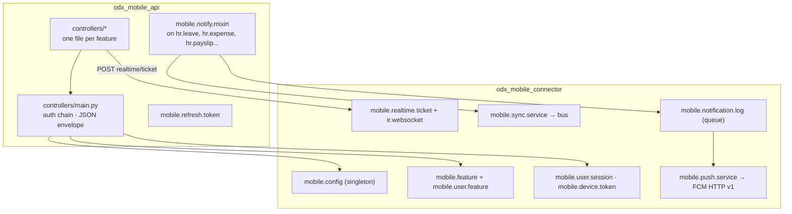

# OFFY Odoo modules: technical reference

Backend for the OFFY mobile app: two Odoo 19 **Enterprise** modules that add a token-authenticated REST API under `/api/mobile/v1`, realtime sync over Odoo's bus, optional Firebase push, and the admin screens that control the app.

> End-user setup (installing, enabling users, Firebase, GPS) is in the [main README](../README.md). This file is for developers who maintain or extend the modules.

| Module | Version | Licence | Role |
|---|---|---|---|
| [`odx_mobile_connector`](odx_mobile_connector) | 19.0.1.90.0 | LGPL-3 | Configuration, feature access, sessions, devices, realtime, push, mobile content |
| [`odx_mobile_api`](odx_mobile_api) | 19.0.1.90.0 | LGPL-3 | HTTP controllers, authentication tokens, business endpoints |

---

## Requirements

- Odoo **19.0 Enterprise**. `odx_mobile_api` depends on `hr_payroll`, which is Enterprise-only.
- Both folders on the same `addons_path`, together with the Enterprise addons.
- No Python packages beyond Odoo's `requirements.txt` (`requests`, `cryptography` and `pytz` ship with Odoo).

## Install

Install **only** `odx_mobile_connector`. `odx_mobile_api` is `auto_install: ["odx_mobile_connector"]` and comes with it.

```bash
odoo-bin -c odoo.conf -d DB -i odx_mobile_connector --stop-after-init
# upgrade after pulling new code (always upgrade both, then restart)
odoo-bin -c odoo.conf -d DB -u odx_mobile_connector,odx_mobile_api --stop-after-init
```

`odx_mobile_connector` has a `pre_init_hook`. If the API folder is missing, or `hr_payroll` can't be found, it refuses to install with a clear message instead of failing halfway.

---

## Architecture



### Request lifecycle

Every authenticated route calls `MobileApiController._authenticate_mobile()` in `odx_mobile_api/controllers/main.py`:

1. Read `Authorization: Bearer <token>`. If it is missing, the reply is **401** `missing_access_token`.
2. Validate it as a `res.users.apikeys` key with scope **`mobile_api`**. If it is invalid or expired, the reply is **401** `invalid_access_token`.
3. Switch the request environment to that user (`request.update_env(user=uid)`). From here on, Odoo access rights and record rules apply.
4. Run `_check_mobile_access`, which checks four things: login is enabled, maintenance mode is off, the user is in `group_mobile_user`, and the user is linked to an active employee.
5. Apply the company context from the `X-Mobile-Session` header, so each device remembers the company it selected.
6. Feature routes then check the feature grant. A missing grant returns **403** with a feature-specific code (e.g. `time_off_access_denied`).

### Response envelope

All JSON replies go through `_json()`:

```json
{ "success": true,  "message": "…", "data": { } }
{ "success": false, "message": "…", "code": "machine_readable_code", "data": {} }
```

Keep this shape for new endpoints; the app's error handling depends on `success`, `code` and the HTTP status.

### Authentication tokens

| Token | Storage | Lifetime | Notes |
|---|---|---|---|
| Access | Core `res.users.apikeys`, scope `mobile_api` | `mobile.config.session_timeout` (default 60 min) | Sent as Bearer on every call |
| Refresh | `mobile.refresh.token`, SHA-256 hash only | 30 days | **Rotated** on each `auth/refresh`; old one revoked immediately |

A password change revokes every token for that user. `max_devices` (default 1) signs out the oldest session when the limit is exceeded.

### Realtime sync

`/websocket` is cookie-authenticated in core Odoo, so it can't see a Bearer token. To get round this:

1. The app calls `POST realtime/ticket`, which returns a single-use ticket valid for 60 seconds. Only its hash is stored.
2. The app opens `wss://host/websocket?ticket=…`. The `ir.websocket` override consumes the ticket and subscribes the socket to the user's partner channel.
3. `mobile.sync.service.notify_home(users, sections)` and `notify_access(users)` push small "this is stale" messages over the bus. The app then refetches. These helpers **never raise**, so a sync failure can't break the transaction that triggered it.

### Push notifications

1. Business models inherit `mobile.notify.mixin`. On state changes (leave approved, expense paid, payslip ready…) it writes a `mobile.notification.log` row. That row is the in-app notification, whether or not push is enabled.
2. The **Dispatch Queued Notifications** cron (every minute) sends queued rows through `mobile.push.service`. It uses the FCM HTTP v1 API with an OAuth token signed from the service-account JSON stored on `mobile.config`.
3. Failing device tokens are counted. With **Auto-Deactivate Failed Tokens** on, a token is disabled after `firebase_token_failure_limit` failures (default 5) within `firebase_token_failure_window_hours` (default 72).
4. A constraint prevents saving `push_notifications_enabled = True` without a credential.

---

## Data model

### `odx_mobile_connector`

| Model | Purpose |
|---|---|
| `mobile.config` | Singleton settings: login switch, maintenance, session timeout, max devices, GPS geofence, logging, Firebase credential and token-failure policy |
| `mobile.feature` | Switchable features. Shipped codes: `attendance`, `expense`, `time_off`, `payslip`, `calendar` |
| `mobile.user.feature` | User ↔ feature grant. A row means full access; no row means hidden (deny by default) |
| `mobile.user.session` | Signed-in devices: platform, app version, last activity |
| `mobile.device.token` | FCM registration tokens per device, with failure counters |
| `mobile.notification.log` | In-app notifications and the push queue |
| `mobile.realtime.ticket` | Single-use websocket tickets (hashed) |
| `mobile.sync.service` | Abstract: bus messages to connected apps |
| `mobile.push.service` | Abstract: FCM HTTP v1 client |
| `mobile.privacy.policy`, `mobile.terms.condition`, `mobile.faq` | Content shown in the app; publishable from the backend |
| Extensions | `res.users` (Mobile User flag, access level, feature grants), `hr.employee`, `hr.attendance`, `hr.work.location` (per-location geofence), `ir.websocket` |

### `odx_mobile_api`

| Model | Purpose |
|---|---|
| `mobile.refresh.token` | Hashed, rotating refresh tokens |
| `mobile.notify.mixin` | Abstract mixin that turns record changes into notifications |
| `mobile.list.filter` | Per-user applied list filters (time off, payslips, expenses), stored as JSON |
| Extensions | `hr.leave`, `hr.leave.allocation`, `hr.expense`, `hr.payslip`, `hr.attendance`, `calendar.event`, `resource.calendar.leaves`, `account.partial.reconcile`, `res.users`, `product.template` (expense category icons) |

### Security groups

| XML id | Name | Grants |
|---|---|---|
| `group_mobile_user` | Mobile User | Use the app. No backend menus |
| `group_mobile_viewer` | Mobile App View Access | Read OFFY Connector menus |
| `group_mobile_manager` | Mobile App Manager | Edit features, grants, sessions, FAQ |
| `group_mobile_admin` | Mobile App Administrator | Everything, including Configuration and the Firebase credential (credential fields are admin-only) |

Portal and public users can never hold any of these groups.

### Scheduled actions

| Cron | Interval |
|---|---|
| Mobile Push: Dispatch Queued Notifications | 1 minute |
| Mobile Realtime: Cleanup Expired Tickets | 1 day |
| Mobile Push: Cleanup Stale Firebase Tokens | 1 day |
| Mobile API: Cleanup Refresh Tokens | 1 day |

---

## Folder layout

```
odx_mobile_connector/
├── __manifest__.py        depends: bus, mail, hr, hr_attendance
├── __init__.py            pre_init_hook (dependency check)
├── models/                config, features, sessions, devices, push, realtime, content
├── views/                 backend screens and menus
├── security/              groups, ACLs
├── data/                  features, default config, crons, content, neutralize.sql
├── migrations/            19.0.1.1.0 … 19.0.1.4.0
├── static/                icon, backend JS/XML (user-access search, chatter)
└── tests/

odx_mobile_api/
├── __manifest__.py        depends: odx_mobile_connector, hr_holidays, hr_payroll, hr_expense, calendar…
├── __init__.py            uninstall_hook (removes mobile_api API keys)
├── controllers/           main.py (auth, envelope) + one file per feature
├── models/                business-model extensions, refresh token, notify mixin
├── filter_sources.py      list-filter definitions
├── notifications.py       notification catalogue (titles, bodies, targets)
├── data/                  refresh-token cron, neutralize.sql
├── docs/                  EXPENSE_ICONS.md
├── tools/                 generate_expense_icon_reference.py
└── tests/                 43 test modules
```

---

## Endpoints

All endpoints are under `/api/mobile/v1` and are `type="http"`, `auth="none"`, CSRF-exempt and JSON. All except `auth/login` and `auth/refresh` require a Bearer token.

| Area | Endpoints | File |
|---|---|---|
| Auth | `POST auth/login` · `POST auth/refresh` · `POST auth/logout` · `PATCH auth/company` | `main.py` |
| User | `GET user/access-details` · `GET company` | `user.py` |
| Home | `GET home` · `GET home/recent-activities` · `GET recent-activities` | `home.py`, `activity.py` |
| Attendance | `GET attendance/logs` · `POST attendance/action` | `attendance.py` |
| Time off | `GET timeoff` · `types` · `history` · `upcoming` · `calendar/month` · `calendar/day` · `POST timeoff/duration` · `POST timeoff/request` | `timeoff.py` |
| Payslip | `GET payslip` · `payslip/list` · `payslip/<id>` · `payslip/<id>/file` · `payslip/<id>/download` | `payslip.py` |
| Expense | `GET expense/summary` · `expense/categories` · `GET/POST/PATCH expense` · `POST expense/<id>/submit` · `DELETE expenses/<id>` | `expense.py`, `uploads.py` |
| Calendar | `GET calendar/month` · `calendar/day` · `POST calendar/events` · `PATCH/DELETE calendar/events/<id>` | `calendar.py` |
| Profile | `GET profile` · `profile/avatar` · `profile/employee-documents/<code>` · `profile/documents/<id>/download` · `…/preview` | `profile.py` |
| Comments | `GET/POST/PATCH/DELETE log-note/messages` · `GET log-note/mention-suggestions` · `GET log-note/attachments/<id>` | `log_note.py` |
| Lists | `GET filters/options` · `GET filters` · `POST filters/apply` | `filters.py` |
| Notifications | `GET notifications` · `DELETE notifications/<id>` · `POST device-token` | `notification.py`, `device_token.py` |
| Realtime | `POST realtime/ticket` | `realtime.py` |
| Content | `GET privacy-policy` · `terms-conditions` · `faqs` · `other-data` | `content.py` |

Quick check:

```bash
curl -s -X POST https://hr.example.com/api/mobile/v1/auth/login \
  -H 'Content-Type: application/json' \
  -d '{"login": "user@example.com", "password": "secret"}'
```

The app never sends a database name, so a multi-database server needs `dbfilter` to select one by host. Otherwise the reply is a 404.

---

## Extending

### Add a switchable feature

1. Add a `mobile.feature` record with a new `code` in your module's data XML. `odx_mobile_connector/data/mobile_feature_data.xml` shows the pattern.
2. In your controller, authenticate with `_authenticate_mobile()`, then check the grant the same way the existing feature controllers do. Return 403 with a specific `code` when it's missing.
3. The feature appears in `user/access-details`. The app reads it with `hasFeature('<code>')`.

### Add an endpoint

- Put it in the matching `controllers/<feature>.py`, or a new file imported from `controllers/__init__.py`. Inherit the shared controller class so the helpers are available.
- Use `type="http", auth="none", csrf=False` and add `readonly=False` for writes.
- Build replies with `self._json(...)`, validate input with `parse_date` / the boolean parser in `main.py`, and return amounts with `amount_2dp`.
- Run as the authenticated user. If a `sudo()` is genuinely required (for example reading configuration), keep it narrow, filter the result to the caller's employee and companies, and leave a one-line comment explaining why.

### Trigger app refreshes and notifications

- To make open apps refetch, call `env["mobile.sync.service"].notify_home(users, ["timeoff", …])`.
- For a notification, inherit `mobile.notify.mixin` on the model and add an entry in `notifications.py`.

---

## Tests

```bash
odoo-bin -c odoo.conf -d test_db -i odx_mobile_connector \
  --test-enable --test-tags /odx_mobile_api,/odx_mobile_connector --stop-after-init
```

Tests live in each module's `tests/` folder. They create their own users, employees and companies. Use a disposable database.

---

## Operations

- **Production copies:** `odoo-bin neutralize -d COPY` runs each module's `data/neutralize.sql`. It removes the Firebase credential, device tokens, sessions, tickets, the notification queue, refresh tokens and `mobile_api` API keys. It does **not** reset the geofence coordinates.
- **Uninstall:** `uninstall_hook` deletes every `mobile_api`-scoped API key. Other API keys are left alone.
- **Proxy:** forward `/websocket` with the `Upgrade` headers to the gevent port, set `proxy_mode = True`, and set `web.base.url` to the public HTTPS address. Payslip and attachment URLs are built from it.
- **Secrets:** never commit a Firebase service-account JSON. It is uploaded through the backend and stored on `mobile.config`.

---

## Support and feedback

E-mail [anjanap@flow.odoxsofthub.com](mailto:anjanap@flow.odoxsofthub.com) · Phone [+91 79079 60048](tel:+917907960048) · WhatsApp [wa.me/917907960048](https://wa.me/917907960048). See the [main README](../README.md#22-support-and-feedback) for the details to include in a request. Feature requests and feedback are welcome at the same contacts.

## Licence

Copyright (C) 2026 Odox SoftHub LLP. The Odoo modules in this folder are licensed under the GNU Lesser General Public License v3.0: see [`LICENSE`](LICENSE) and [`COPYING`](COPYING). Third-party components keep their own licences; see [section 23.1 of the main README](https://github.com/odoxsofthub/offy/blob/offy-odoo-19-enterprise/README.md#231-third-party-components).

---

Odox SoftHub LLP · LGPL-3 · Odoo is a trademark of Odoo S.A.; this project is not affiliated with it.
